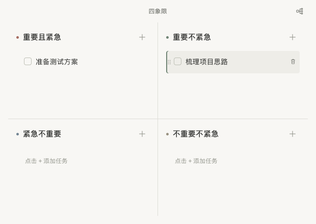
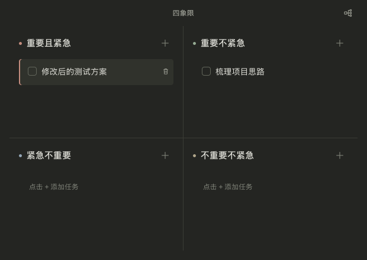

# 四象限

极简、本地、只做四象限任务管理的 macOS 桌面应用。

使用 Tauri 2 + React + TypeScript 开发。无需服务器、账号、网络或订阅，任务自动保存在本机。主窗口采用 2×2 任务矩阵。1.3.2 起已移除悬浮小组件及其菜单、快捷键和自动恢复功能。

## 思维导图

主窗口右上角有一个小导图按钮。先单击选中任务，再点击右上角按钮；首次可新建或关联已有 `.xmind` 文件，已有关联直接使用 Xmind 打开。新建导图的中心主题是任务名称，自动存入 `~/Documents/四象限导图/`；关联已有文件保留其原位置。

改名、完成、移动象限和重启应用均保留关联；删除任务只清除关联，保留导图文件。外部文件被移动或删除时，可重新选择文件恢复关联。导图内容在 Xmind 中编辑和保存，四象限不修改已有关联文件的内容。

## 1.2.0 · Codex 秘书接口

新增应用自带的本地 MCP 与 CLI，支持查询、新增、修改、完成和删除任务。应用关闭时也能写入，打开时主窗口约 1 秒内刷新；所有操作共用原生 SQLite 事务，不增加界面模块。

将本机新版安装到 Applications 后，可连接 Codex：

```sh
codex mcp add four-quadrants -- '/Applications/四象限.app/Contents/MacOS/four-quadrants' --mcp
```

本机聊天加载工具并收到待办约定后，可说“帮我加入四象限，准备项目方案，重要但不紧急”。任务分类由秘书根据表达决定，无法判断时应询问。侧栏常驻秘书（Your dot）还需要通过已连接的 Mac 调用；截至 2026-10-18，其长期规则尚未写入，也未完成秘书端调用验收。完整工具、CLI 用法和可复制的规则见 [Codex 接入说明](docs/CODEX.md)。

当前仓库提供 1.3.2，包含本地 MCP/CLI、Xmind 导图关联和单主窗口界面。安装包位于 `release/`；本机已安装到 `/Applications/四象限.app`。验证结果见 [验证记录](docs/VERIFICATION.md)。

## 下载与安装（1.3.2）

| 安装包 | 下载 | 适用平台 |
| --- | --- | --- |
| DMG 安装镜像，约 3.0 MB | [下载 DMG](https://github.com/MY-123-hub/four-quadrants/raw/refs/heads/main/release/%E5%9B%9B%E8%B1%A1%E9%99%90_1.3.2_aarch64.dmg) | Apple Silicon Mac，macOS 11+ |
| `.app` 压缩包，约 2.3 MB | [下载 ZIP](https://github.com/MY-123-hub/four-quadrants/raw/refs/heads/main/release/%E5%9B%9B%E8%B1%A1%E9%99%90_1.3.2_aarch64.app.zip) | Apple Silicon Mac，macOS 11+ |

打开 DMG，把“四象限”拖入 Applications 后启动。也可解压 ZIP，直接打开 `四象限.app`。安装包直接存放在本仓库的 [release](release) 目录，无需安装 Node.js 或 Rust。

**当前提供 arm64 版本（M 系列 Mac），尚未提供 Intel / Universal 安装包。未使用 Apple Developer 身份签名或公证。**

校验下载文件：

```sh
shasum -a 256 四象限_1.3.2_aarch64.dmg
```

预期校验值见 [SHA256SUMS.txt](release/SHA256SUMS.txt)。

## 窗口

仅保留主窗口。关闭窗口先提交编辑、等待保存后隐藏，Cmd+Q 或菜单退出才结束应用；点击 Dock 图标或使用“窗口 → 打开主窗口”（Cmd+Shift+M）可重新显示。窗口位置和尺寸会保留，显示时会根据当前屏幕工作区调整位置。

## 界面

浅色模式：



深色模式：



截图中的任务仅为演示，首次启动没有预置任务。主题自动跟随 macOS 系统。

## 使用

- 点击象限右上角的 `+`，输入任务名称，按 Enter 或点击别处保存。
- 单击任务文字选中，再点击右上角导图按钮创建或打开导图。双击文字、Enter 或 F2 原位改名；编辑时 Enter 保存，Escape 取消。中文输入法选字不会提前提交。
- 勾选完成，任务淡化并加删除线；再次勾选可取消完成。
- 悬停任务时，左侧出现拖动手柄，右侧出现删除按钮。
- 拖动手柄可在四个象限之间移动任务，也可调整同一象限内的顺序。
- 支持键盘拖放：聚焦手柄，按空格开始、方向键移动、空格放下，Escape 取消。
- 所有操作自动保存。关闭窗口会先提交当前编辑并等待保存完成，然后隐藏；Cmd+Q 和菜单退出会等待主窗口确认保存完成后退出。

四个象限各自滚动，窗口缩放时保持 2×2。没有登录、云同步、日历、统计或标签；软件不内置 AI，外部助手可通过 MCP/CLI 操作任务。

## 本地数据

正式任务保存在 SQLite：

```text
~/Library/Application Support/com.local.fourquadrants/tasks.sqlite3
```

数据不放在应用包或代码仓库中。退出、重新打开或替换应用包，已有任务仍保留。

SQLite 使用 WAL 和 `synchronous=FULL`，每次任务变更在事务中合并到最新文档，递增 revision 后更新主窗口。读盘失败不会把旧数据重置为空；写盘失败会保留窗口中的修改，显示重试入口，并阻止未保存的退出。

备份时先退出应用，再复制整个 `com.local.fourquadrants` 目录；导图文件需要另外备份（新建文件位于 `~/Documents/四象限导图/`，关联文件位于原位置）。

浏览器预览使用独立的 localStorage，仅供开发，与正式应用数据隔离。

## 开发

需要 Node.js 22+、Rust stable 和 macOS Xcode Command Line Tools。

```sh
git clone https://github.com/MY-123-hub/four-quadrants.git
cd four-quadrants
npm ci
npm run tauri -- dev
```

只查看浏览器预览：

```sh
npm run dev
```

## 测试与构建

```sh
npm run build
npm run test
npx playwright install chromium webkit
npm run test:e2e
cargo test --manifest-path src-tauri/Cargo.toml --release
npm run tauri -- build --bundles app
npm run package:macos
```

macOS 构建需要在 Mac 上进行。原始产物分别位于：

```text
src-tauri/target/release/bundle/macos/四象限.app
release/四象限_1.3.2_aarch64.dmg
release/四象限_1.3.2_aarch64.app.zip
```

`npm run package:macos` 构建应用、进行本机 ad-hoc 签名，并生成 DMG / ZIP 与 SHA256SUMS，避免依赖 Finder 自动排版。ad-hoc 签名不等同于 Apple Developer 签名或公证。

目前通过 12 项前端规则与同步队列测试、20 项 Chromium / WebKit 交互检查、14 项 Rust 持久化、导图、MCP 协议与并发测试。历史版本与本轮原生验收见验证记录。整机重启、多个实体显示器及其他 Mac 硬件尚未现场验证。

## 项目结构

```text
src/domain/       任务结构、校验与移动排序规则
src/storage/      存储适配、变更队列与跨窗口同步
src/components/   任务行、原位编辑与四象限布局
src/mindmaps/     导图原生命令适配
src/windows/      前端窗口动作与生命周期
src-tauri/src/    原生 SQLite、CLI/MCP、窗口状态和退出协调
docs/             设计取舍、截图和验证记录
release/          可直接下载的安装包
```

[设计与架构](docs/DESIGN.md) · [Codex 接入与排障](docs/CODEX.md) · [验证与交接状态](docs/VERIFICATION.md)

## 许可证

项目代码以 [MIT License](LICENSE) 开源。

Geist 字体本地打包，遵循 [SIL Open Font License 1.1](docs/Geist-OFL.txt)。中文使用 macOS 系统苹方。依赖许可文本见 [第三方声明](docs/THIRD-PARTY-NOTICES.txt)，并包含在应用包内。
